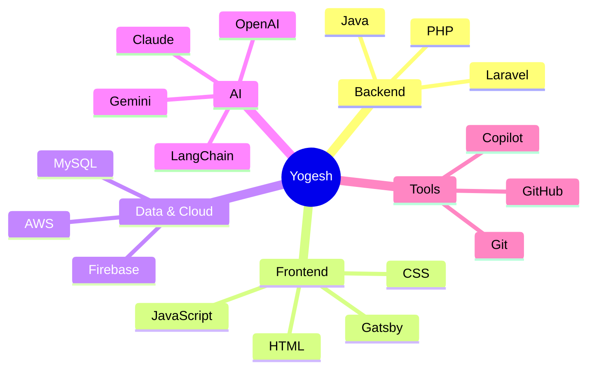

<!-- ================= HEADER ================= -->

 

 

## 👨‍💻 About Me

- 🧑‍💻 Software Developer with **6+ years** in **PHP** and **4+ years** in **Laravel**
- 🌍 Based in **India** 🇮🇳
- 🤖 Exploring **AI & LLMs** — bringing OpenAI, Claude & Gemini into real-world web apps
- 🧠 Currently learning **Full Stack Development**
- ⚡ *"The best teacher is you — you teach yourself."*

<b>⚡ Quick facts — click to expand</b>

 

| | |
|---|---|
| 🧑‍💻 **Experience** | 6+ years PHP · 4+ years Laravel |
| 🌍 **Location** | India 🇮🇳 |
| 🧠 **Learning** | Full Stack Development |
| 🤖 **Exploring** | AI tools & LLM APIs |
| 💬 **Ask me about** | PHP, Laravel, MySQL, REST APIs |
| ✉️ **Contact** | eng.yogesh.it@gmail.com |

## 🛠️ Tech Stack
Hover for name · click to open docs

  
  
  
  
  
  
  
  
  
  
  
  

## 🤖 AI & Machine Learning

  

  
  
  
  
  
  
  

<b>🗺️ Skill map — click to expand</b>

 

## 📊 GitHub Stats

  

  
  

<b>🔥 Streak & 🏆 trophies — click to expand</b>

 

  

  

<!-- ================= FOOTER ================= -->

